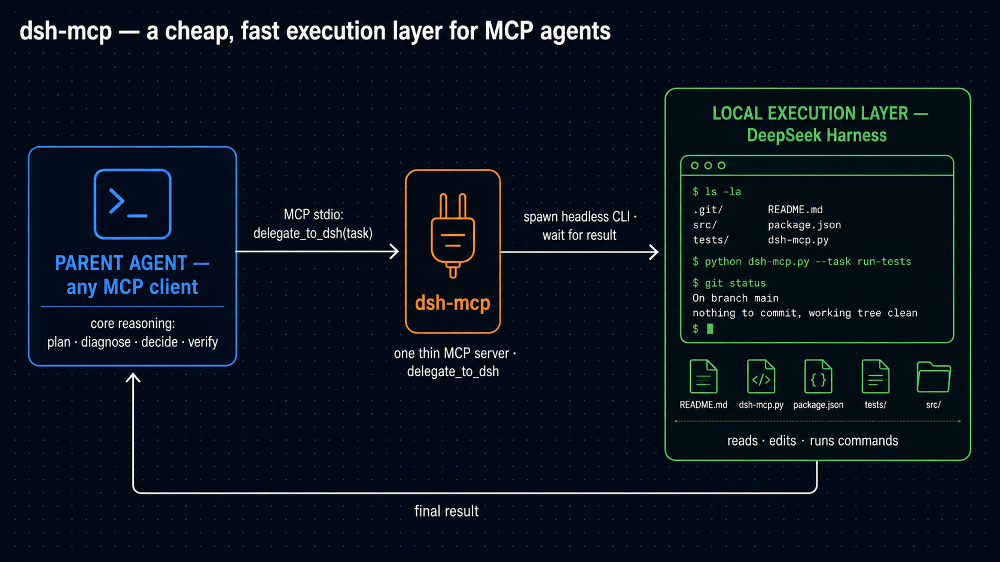

<div align="center">

# dsh-mcp ⚡

### ファイルの読み込みに、フラッグシップモデルの料金を払うのはもうやめよう。

### MCP エージェントのための、安くて速い実行層 —— ローカル DeepSeek Harness が支える。

エージェント型のコーディングツールが高くて遅い理由は、ひとつしかありません。
フラッグシップモデルにファイルを1つずつ読ませているからです。`dsh-mcp` はその
流れを逆転させます——**親エージェントが推論を持ち、ローカル DeepSeek Harness が
重労働を請け負う**：一括の読み込み・編集・コマンド実行を、DeepSeek 価格で、
あなたのマシン上で。


**あらゆる MCP クライアントで動作 · Claude Code でのエンドツーエンド検証済み**

**🌐 [English](README.md) · [简体中文](README.zh-CN.md) · [日本語](README.ja-JP.md)**

</div>

---

## なぜ：速くて安いのは、設計の結果です

**問題。** 長期・複数ファイルにわたる作業は、エージェント型ツールが時間とお金を
最も消耗する場面です。Codex も Claude Code も、フラッグシップモデルに全ファイル
を自ら読ませる方式です。ファイルごとに `Read` を繰り返し、探索ループを回し、
コンテキストは肥大して話があちこちに逸れていく。**読み込みそのものに**
フラッグシップモデルの単価を払い、しかもモデルが**1 つずつ**読む——時間も
お金も、二重に失われていきます。

**解決策。** 一度の `delegate_to_dsh` で、トークンを最も消費するサブタスクを
丸ごと、新しい独立した DeepSeek Harness エージェントへ渡します。実行はあなたの
ワークスペース内。ファイル I/O はすべてそちらで——一括で、ローカルで、安く。
親エージェントは判断を下す立場に留まり、本当に頭を使う部分だけを担います：
**計画・診断・判断・検証**。

20 の SWE-bench スタイル長期タスクでの実測（親モデルは両群とも同一）：

| | dsh-mcp あり | 素のエージェント |
|---|---|---|
| **正解率** | **20/20 · 100%** | 17/20 · 85% |
| **平均所要時間** | **77s** | 107s |
| **複数ファイル調査系** | **43–83s** | 最大 **350s** |

速く、正確に——しかも最もコストのかかる読み込みは、もうフラッグシップモデルの
仕事ではありません。[完全なレポート](#benchmark-レポート) · [自分で再現](#benchmark-レポート)

## 仕組み



*生成に使ったプロンプトは
[`docs/architecture-image-prompt.md`](docs/architecture-image-prompt.md) に
あります。*

- **Claude Code 専用ではありません。** `dsh-mcp` は標準の MCP stdio サーバーです。
  MCP を話せるクライアントならどれでも使えます——Claude Code は、私たちが
  エンドツーエンドで検証したクライアントにすぎません（実 API 呼び出し、
  サブディレクトリ起動、中国語、パス内スペースを確認済み）。
- **親エージェント・モデル。** 各委譲は自己完結型のサブタスクひとつ。DSH は
  ステートレスなワーカーです（呼び出しごとに新しいプロセス。汚染される
  セッションは存在しません）。
- **設定なしでそのまま動く。** DSH CLI を自動検出します（環境変数による
  上書き → 兄弟 checkout → 子ディレクトリ checkout → `%USERPROFILE%\.dsh` に
  インストール済みの CLI）。
- **Windows ファースト。** `process.execPath` + 明示的な argv、`shell: false`——
  引用符地獄も `.cmd` シムもなし。スペースを含むパスもそのまま動きます。

## クイックスタート

**ステップ 1 — ビルド（一度だけ）**

```powershell
cd dsh-mcp
npm install
npm run build                      # → dist\index.js
```

**ステップ 2 — Claude Code に登録**

```powershell
claude mcp add dsh `
  --transport stdio `
  --env DEEPSEEK_API_KEY=sk-... `
  -- node D:\path\to\dsh-mcp\dist\index.js

claude mcp list                    # 一覧に "dsh" があることを確認
```

**ステップ 3 — Claude Code を再起動し、最初の委譲を実行**

MCP サーバーは起動時に読み込まれるので、任意のプロジェクト内で再起動して
から、ふつうの言葉で頼むだけです：

> DSH にこのプロジェクトの README.md と package.json を読ませ、プロジェクト名と
> README の最初の段落を報告させてください。ファイルは自分では読まないで——
> すべて委譲してください。

Claude が `delegate_to_dsh` を呼び出し、数秒で答えが返ってきます。DSH は
**あなたの**プロジェクトルートで実行されます——決して `dsh-mcp` ディレクトリ
では実行されません。

> `delegate_to_dsh` が表示されない？もう一度 `claude mcp list` を実行——
> サーバーの起動失敗はそこでエラーとして表示されます。
> [トラブルシューティング](#トラブルシューティング) へ。

## Benchmark レポート

> 20 の長期・複数ファイルタスク（バグ修正、リファクタリング、移行、仕様からの
> 実装、テスト駆動、監査）· 自動化された ground-truth 検証（実行アサーション +
> stdout チェック）· 親モデルは両群とも同一
> · 完全な詳細：[`tests/bench/bench-report.md`](tests/bench/bench-report.md)
> · タスクセット：[`tests/bench/tasks.mjs`](tests/bench/tasks.mjs)

| タスク | dsh-mcp あり | 素のエージェント |
|---|---|---|
| 01 エクスポート名変更（全参照を更新） | ✅ 120s | ✅ 47s |
| 02 カスケードバグ（3 層データフローの欠落フィールド） | ✅ **55s** | ❌ 158s |
| 03 仕様からの実装 | ✅ 42s | ✅ 42s |
| 04 util の移行（呼び出し側 3 箇所を更新） | ✅ **60s** | ✅ 300s |
| 05 5 ファイルの一括修正 | ✅ **67s** | ✅ 155s |
| 06 CJS → ESM 移行 | ✅ 34s | ✅ 51s |
| 07 null ガード修正 | ✅ 54s | ✅ 71s |
| 08 仕様どおりに checksum を実装 | ✅ 28s | ✅ 48s |
| 09 データフロー（3 層の根本原因追跡） | ✅ **43s** | ✅ 350s |
| 10 共通モジュールへの抽出 | ✅ 282s | ✅ 76s |
| 11 非同期境界の修正 | ✅ 52s | ✅ 55s |
| 12 範囲外アクセスのガード | ✅ 64s | ✅ 67s |
| 13 設定キーの移行 ×2 | ✅ 92s | ✅ 67s |
| 14 undefined ガード修正 | ✅ **83s** | ✅ 287s |
| 15 文字列連結の順序 | ✅ **23s** | ❌ 67s |
| 16 循環 require | ✅ **228s** | ❌ 53s |
| 17 失敗するテストスイートの修正 | ✅ 49s | ✅ 50s |
| 18 単位換算 | ✅ 68s | ✅ 77s |
| 19 ログ監査（3 エントリ） | ✅ 77s | ✅ 86s |
| 20 ソート比較器の向き | ✅ 29s | ✅ 32s |

**数字が示すこと**

- **複数ファイル調査系タスク：3〜8 倍高速。** 委譲ひとつで「N ファイルの読み込み +
  分析」を一括処理します（09: 43s vs 350s）。素のエージェントはファイルを 1 つずつ
  読み、長いセッションでは初期の内容を失います。
- **素のエージェントの失敗 3 件はすべて精密作業系** —— 3 モジュールにまたがる
  欠落フィールド、1 行の連結順序、そして古典的な Node 循環 require の
  `module.exports` 参照置き換えの罠。dsh-mcp 側はすべて解決しました。
- **例外も正直に書いておきます** —— 共通モジュール抽出（10）は DSH 経由のほうが遅い
  （複数ファイル書き換えの往復コスト）。16 番の素の群が「速い」のは、間違った
  修正で早々に諦めただけです。
- **単純な一点修正タスクは互角**（素の群がわずかに速い。委譲ごとにプロセス
  起動コストがかかるため）。

**制限** —— n=20、単一モデル、小規模リポジトリ、素の群はヘッドレス権限モード。
正解率の差は方向として一貫していますが、このサンプルサイズでは統計的に有意では
ありません。

再現：

```powershell
DEEPSEEK_API_KEY=sk-... node tests\bench\run-bench.mjs        # 両群 20 タスク
DEEPSEEK_API_KEY=sk-... node tests\e2e-headless.mjs           # 実 E2E（A/B/C/D）
DEEPSEEK_API_KEY=sk-... node tests\long-horizon-e2e.mjs       # 複数委譲ループ
```

> キーはサンドボックス内の一時 `mcp.json` にのみ置かれ、終了時に削除されます——
> リポジトリに書き込まれることも、出力されることもありません。

## 設定

### 方法 A — Claude Code への登録（推奨）

```powershell
claude mcp add dsh `
  --transport stdio `
  --env DEEPSEEK_API_KEY=sk-... `
  -- node D:\path\to\dsh-mcp\dist\index.js

claude mcp list
```

> 他の MCP クライアントでも同じサーバーをそのまま使えます——`dist\index.js` を
> 指し、同じ環境変数を設定してください。プロジェクトレベルの設定例：

```json
{
  "mcpServers": {
    "dsh": {
      "command": "node",
      "args": ["D:\\path\\to\\dsh-mcp\\dist\\index.js"],
      "env": { "DEEPSEEK_API_KEY": "sk-..." }
    }
  }
}
```

> キーを git にコミットしないでください。自動化スクリプトは終了前に一時設定を
> 削除します。

### DSH はどこにインストールできますか？

dsh-mcp が DSH を探すのは、順番に見ていく正確に 4 か所だけです——
**`PATH` は見ません**：

1. `DSH_ROOT` 環境変数——明示指定。無条件に最優先
2. このパッケージの隣の checkout：`..\deepseek-harness`
3. このパッケージ内の子 checkout：`.\deepseek-harness`
4. DSH home 配下にインストールされた CLI パッケージ：
   `%USERPROFILE%\.dsh\profiles\node_modules\@deepseek-ai\dsh`
   （`DSH_HOME` で home を上書き可能）

つまり DSH は**どこにインストールしても構いません**——兄弟 checkout、
専用のツールディレクトリ、別ドライブでも——`DSH_ROOT` で指定すれば
OK です。どちらのレイアウトも認識します：ソース checkout（先に CLI を
ビルド：`pnpm install && pnpm run build`）またはインストール済み CLI
パッケージ（`<root>\lib\bin.js`）。この 4 か所以外は自動検出されません。
エラーメッセージが `DSH_ROOT` の設定を案内します。

```powershell
# 自分のディレクトリにある DSH を登録
claude mcp add dsh `
  --transport stdio `
  --env DEEPSEEK_API_KEY=sk-... `
  --env DSH_ROOT=D:\tools\deepseek-harness `
  -- node D:\path\to\dsh-mcp\dist\index.js
```

### 環境変数

| 変数 | 意味 |
| --- | --- |
| `DEEPSEEK_API_KEY` | **必須**。DSH 子プロセスへ環境経由で渡されます。 |
| `DSH_ROOT` | 任意。DSH の checkout / インストール済み CLI を指定。 |
| `DSH_HOME` | 任意。DSH home（既定 `%USERPROFILE%\.dsh`）。 |
| `DSH_MCP_TIMEOUT_MS` | 任意。子プロセスのタイムアウト；**未設定 = タイムアウトなし**。 |
| `DSH_MCP_DEBUG=1` | stderr 診断（`[dsh-mcp] dshRoot=... cli=...`）。 |

### トラブルシューティング

| 症状 | 対処 |
| --- | --- |
| `Unable to locate DeepSeek Harness` | `DSH_ROOT` を設定するか、DSH CLI をインストール（`npx @deepseek-ai/dsh`） |
| `CLI build artifact is missing` | DSH checkout で `pnpm install && pnpm run build` |
| `DEEPSEEK_API_KEY is not configured` | `--env DEEPSEEK_API_KEY=...` を付けて再登録し、Claude Code を再起動 |
| ワークスペースが違う | 解決順：ツール `cwd` → `CLAUDE_PROJECT_DIR` → `MCP_WORKSPACE_DIR` → サーバー cwd |

## 委譲のしかた

`delegate_to_dsh` は `task` 引数をひとつ取ります。呼び出しのたびに**真新しい**
DSH エージェントが起動し、あなたのワークスペースで実行されて、最終結果を
返します。DSH は呼び出しをまたいだ**記憶を持ちません**——これが設計です
（汚染されるセッションが存在しない）——そして、それこそが唯一の鉄則を
決めます：

> **すべての委譲は自己完結に。** サブタスクに必要なものをすべて DSH に
> 渡してください：ファイルパス、コンテキスト、期待する結果。
> 「上と同じ」「さっきのように」「さっき言ったあのファイル」は禁止——
> DSH はあなたの会話を見られません。

### 良い委譲 vs 悪い委譲

同じタスク、2 通りの書き方：

```text
❌ 「store モジュールのバグを修正して検証して。」
   —— どのモジュール？ どのバグ？ どう検証する？ DSH は「そのバグ」を
      知りません。

✅ 「src/store.js の createOrder()（42 行目あたり）が注文合計の計算で
    tax フィールドを無視しています。合計に税が含まれるよう修正して
    ください。その後 node src/tests/order.test.js を実行し、出力を
    報告してください。」
   —— 自己完結：ファイル、バグ、期待する動作、検証コマンドが揃っています。
```

### ほとんどのケースをカバーする 3 つのテンプレート

**1. 調査 — DSH が読み、親がレポートを読む**

```text
src/modules/ の a.js、b.js、c.js を読んで報告してください：(1) 各ファイルが
エクスポートする関数シグネチャの一覧、(2) TODO/FIXME コメントと行番号、
(3) 各モジュールがどこから import されているか。変更はしないでください。
```

**2. 修正 + 検証 — 親が判断し、DSH が実行・確認する**

```text
src/utils.js の slugify("  hello ") が "hello " を返してしまいます
（先頭の空白が漏れる）。修正してから node src/test/utils.test.js を
実行し、どのアサーションが通ったか報告してください。
```

**3. 一括編集 — 多数の読み書き往復の代わりに、委譲ひとつ**

```text
プロジェクト全体で、config.port への参照をすべて config.serverPort に
変更してください（node_modules は除外）。変更したファイルを 1 行ずつ
列挙してください。
```

### 委譲すべきとき — すべきでないとき

| 委譲（トークン集約・自己完結） | 親に残す（コンテキストが必要） |
|---|---|
| N 個のファイルの読み込み + 要約 | 2 つのアーキテクチャの比較 |
| 複数ファイルのリネーム / 移行 / リファクタリング | 次に何を作るかの決定 |
| テストスイート / スクリプトの実行と出力報告 | どんどん変わるデバッグの会話 |
| 仕様が明確な関数の実装 | ゴール自体がまだ不明確なもの |

### セッションでの委譲の実際の流れ

```text
あなた:  ログインフローが壊れています。src/auth/ の login.js → session.js →
        db.js の呼び出しの流れを DSH に追跡させ、エラーがどこで握り
        つぶされ得るかを行番号付きで報告させてください。ファイルは
        自分では読まないでください。

DSH:    見つけました：src/auth/session.js:37 がエラーを捕捉して rethrow
        せず null を返すため、login.js は失敗を「未ログイン」として扱って
        います。3 つのファイルを読みましたが、変更はしていません。
```

## コストモデル

本プロジェクトの開発と検証はすべて **deepseek-v4-flash** 上で行われました——
親エージェントも DSH も同様です。アーキテクチャこそが要点です：親の毎ターンの
トークン消費は最小限（純粋な推論のみ）に保たれ、トークン集約的な作業は DSH 側で
DeepSeek 価格により実行されます。

親エージェントをフラッグシップモデル（例：Claude Fable 5 / Sonnet 5）へ
アップグレードしても、**より速く、より安く**なるのはこのためです：

- **より速く** —— benchmark での素の群の失敗はすべて推論の失敗です。より強力な
  親は再試行の代わりに一度で推論し、DSH 側の作業量は変わりません。
- **より安く** —— 親のトークン予算は委譲によってすでに最小化されているため、
  単価が高くても、ファイル読み込みと探索ループに全トークン量を支払う素の
  エージェントより安く済みます。
- **移行ゼロ** —— `delegate_to_dsh` はエンドツーエンドでモデル非依存です。

*フラッグシップモデルに関する主張は、アーキテクチャ分析 + benchmark データからの
推論です。親モデルを差し替えて同じスイートを再実行すれば検証できます。*

## 検証済み

| レイヤー | カバレッジ | 状態 |
| --- | --- | --- |
| ユニットテスト | 23 件の vitest（DSH 検出 / workspace / runner） | ✅ |
| 実 E2E（Claude Code） | サブディレクトリ起動 · 中国語 · パスにスペース · 実 API | ✅ |
| 長期タスク | 計画 → 調査 → 診断 → 修正 → 読み返し → 検証 | ✅ 5/5 |
| A/B benchmark | 20 タスク × 2 群（正解率 + runtime） | ✅ |
| DSH 書き込みプローブ | headless プロファイルでのファイル書き込み | ✅ |

## 設計と制限（V0.x）

- **同期 wait-for-result** —— ストリーミングなし、バックグラウンドなし、ポーリング
  なし（設計ドキュメント §0/§23）。長いタスクは 1 回の長い MCP 呼び出しになり
  ます。既定ではタイムアウトしません。
- **ステートレスワーカー** —— 委譲のたびに新しい DSH プロセスが起動します
  （起動コストあり。単純なタスクでは問題ありません）。
- **並行委譲**が同じワークスペースを同時に変更するのは自己責任です——読み取り
  専用 / 独立したサブタスクを推奨します。
- **Windows ファースト**、MIT ライセンス。設計とエンジニアリング根拠：
  [`DSH_MCP_ENGINEERING(1).md`](DSH_MCP_ENGINEERING(1).md)（§0–§40）。

## 免責事項

`dsh-mcp` は独立したオープンソースプロジェクトであり、**OpenAI・Anthropic・
DeepSeek のいずれとも提携・承認・協力関係はありません**。DeepSeek Harness は
DeepSeek のオープンソースプロジェクトであり、本アダプタは MCP プロトコルを通じて
その CLI と統合しているにすぎません。すべての製品名および商標は、それぞれの
権利者に帰属します。

## License

MIT
